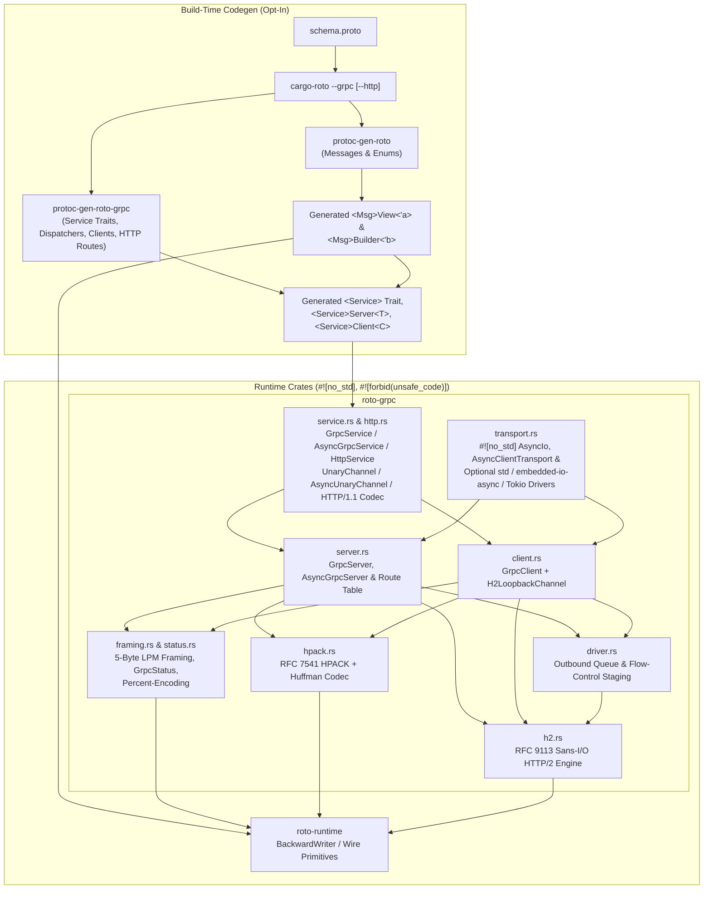
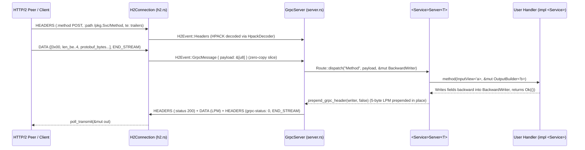

# `roto-grpc`: Zero-Copy `#![no_std]` gRPC over HTTP/2

`roto-grpc` and `protoc-gen-roto-grpc` provide an opt-in, `#![no_std]`, zero-allocation gRPC server and client implementation built around `roto`'s zero-copy Protobuf views (`<Msg>View<'a>`) and single-pass backward builders (`<Msg>Builder<'b>`).

We achieve no-std by building a state machine around HTTP/2 framing and the gRPC protocol.
The user is responsible for providing the HTTP/2 transport layer (e.g. via std::net::TcpListener, or tokio::net::TcpListener).
This implementation does not handle TLS/SSL; if desired, the user can use a TLS/SSL library to provide the transport layer.

---

## 1. Architecture

### Component Relationships



### Zero-Copy Request & Single-Pass Backward Response Flow

1. **Inbound Request (Zero-Copy Fast Path)**:
   - When an HTTP/2 `DATA` frame arrives containing a complete 5-byte gRPC Length-Prefixed Message (LPM) header and payload, [`H2Connection::recv`](../roto-grpc/src/h2.rs) emits `H2Event::GrpcMessage` whose `payload: &'a [u8]` slice borrows directly from the caller's input buffer with zero copying.
   - If a gRPC message straddles multiple HTTP/2 `DATA` frames, `H2Connection` reassembles it into the stream's fixed-capacity inline buffer (`REASM_CAP`).
   - The generated `<Service>Server<T>` constructs `<Input>View::from_bytes(req_payload)` directly over that borrowed slice and invokes the user's trait method.
2. **Outbound Response (Single-Pass `BackwardWriter`)**:
   - The user's handler populates `<Output>Builder<'b>` directly onto a [`BackwardWriter<'b>`](../roto-runtime/src/writer.rs) backed by the server's `msg_buf`.
   - Once the handler returns `Ok(())`, [`prepend_grpc_header`](../roto-grpc/src/framing.rs) prepends the 5-byte `[compressed_flag, len_be_0..4]` gRPC LPM header directly in front of the serialized Protobuf fields in the same buffer without moving a single byte.



---

## 2. Basic How-To Guide

### Step 1: Define a `.proto` Service

Create `proto/sensor.proto`:

```protobuf
syntax = "proto3";
package telemetry.v1;

message Location {
  optional int32 lat_e7 = 1;
  optional int32 lon_e7 = 2;
}

message SensorReading {
  optional string device_id = 1;
  optional uint64 timestamp_ms = 2;
  optional Location location = 3;
}

service SensorCollector {
  rpc ReportLocation(SensorReading) returns (Location);
}
```

### Step 2: Generate `roto` Messages, `roto-grpc` Service Stubs, and Reflection Descriptors

`protoc-gen-roto-grpc` and `FileDescriptorProto` emission are opt-in. We recommend enabling both `--grpc` and `--descriptors` (alongside [`grpc-reflection-roto`](../grpc-reflection-roto/src/lib.rs)) so your server can expose gRPC Server Reflection for runtime inspection with tools like `grpcurl` and `grpc_cli`.

`cargo-roto` automatically discovers `.proto` files inside `--proto-dir` (defaulting to `<crate_root>/proto`) or via `[package.metadata.roto]` in `Cargo.toml` — it does not take `--proto-path` or positional `.proto` file arguments:

```bash
# Recommended: generate roto message views/builders, roto-grpc service stubs,
# and unstripped FileDescriptorProto constants for gRPC Server Reflection:
cargo roto --grpc --descriptors

# Or explicitly override the source .proto directory and output directory:
cargo roto --proto-dir proto --out-dir src/generated --grpc --descriptors
```

Or configure `[package.metadata.roto]` in `Cargo.toml` so plain `cargo roto` runs with your project settings:

```toml
[dependencies]
roto = { path = "../roto", default-features = false }
roto-runtime = { path = "../roto-runtime", default-features = false }
roto-grpc = { path = "../roto-grpc", default-features = false }
grpc-reflection-roto = { path = "../grpc-reflection-roto", default-features = false }

[package.metadata.roto]
proto_paths = ["proto"]          # or `proto_dir = "proto"` (default: "proto")
inputs = ["proto/sensor.proto"]  # optional explicit input files (or `provides = ["telemetry"]`)
out_dir = "src"                  # output directory (default: "src", e.g. "src/generated")
mode = "lib"                     # "lib" (default, emits lib.rs) or "mod" (emits mod.rs + per-package files)
grpc = true                      # invoke protoc-gen-roto-grpc and emit grpc.rs
http = true                      # optional: emit google.api.http HTTP/1.1 & HTTP/2 routes in grpc.rs
descriptors = true               # recommended: emit unstripped FileDescriptorProto bytes for reflection
```

> [!NOTE]
> **Stripping Descriptor Details & Removing the Reflection Service**:
> When `descriptors = true` (or `--descriptors`) is enabled, `protoc-gen-roto` embeds the full, unstripped `google.protobuf.FileDescriptorProto` wire bytes (including `source_code_info` comments, field names, and options) as `FILE_DESCRIPTOR_BYTES` constants and `FILE_DESCRIPTOR_SET` slices in `.rodata`.
>
> If you want to strip out all schema details (e.g., to minimize flash/ROM usage on constrained microcontrollers or prevent schema introspection in hardened production builds):
> 1. Set `descriptors = false` (or omit `descriptors` / `--descriptors`) in `Cargo.toml` and re-run `cargo roto --grpc`. This completely omits `FILE_DESCRIPTOR_BYTES` and leaves `GrpcService::FILE_DESCRIPTOR_SET` empty (`&[]`).
> 2. Remove `grpc-reflection-roto` from `[dependencies]` and remove `refl_v1` / `refl_v1alpha` from your server's `routes` slice so only your application services are mounted.

For `package telemetry.v1;`, running `cargo roto --grpc --descriptors` produces two files in the output directory (`src/` by default):
- **`src/lib.rs`** (or `src/mod.rs` in `mode = "mod"`):
  - `pub mod telemetry { pub mod v1 { ... } }` containing `LocationView<'a>`, `LocationBuilder<'b>`, `SensorReadingView<'a>`, `SensorReadingBuilder<'b>`, and `pub const FILE_DESCRIPTOR_BYTES: &[u8]`
  - `pub mod grpc;` (automatically appended by `cargo-roto` when `--grpc` or `grpc = true` is enabled)
- **`src/grpc.rs`**:
  - `pub mod telemetry { pub mod v1 { pub mod sensor_collector { ... } } }` containing:
    - `pub const SERVICE_NAME: &str = "telemetry.v1.SensorCollector"`, `pub const PATH_REPORT_LOCATION: &str = "/telemetry.v1.SensorCollector/ReportLocation"`, and `pub const FILE_DESCRIPTOR_SET: &[&[u8]]`
    - `pub trait SensorCollector` (sync zero-copy server handler trait)
    - `pub trait AsyncSensorCollector` (async zero-copy server handler trait)
    - `pub struct SensorCollectorServer<T>` (implements [`GrpcService`](../roto-grpc/src/service.rs), [`AsyncGrpcService`](../roto-grpc/src/service.rs), [`Route`](../roto-grpc/src/server.rs), and [`AsyncRouter`](../roto-grpc/src/server.rs))
    - `pub struct SensorCollectorClient<C>` (typed client stub over [`UnaryChannel`](../roto-grpc/src/service.rs) or [`AsyncUnaryChannel`](../roto-grpc/src/service.rs))

### Step 3: Implement the Generated Service Trait

Your handler imports the generated message types from `<crate>::telemetry::v1` and the gRPC service trait from `<crate>::grpc::telemetry::v1::sensor_collector` (shown below using `crate::`, or e.g. `roto_test::` when importing from `main.rs` or an external binary). It borrows the request view directly from the incoming frame and writes the response into the builder without heap allocations:

```rust
use roto_grpc::GrpcStatus;
use crate::grpc::telemetry::v1::sensor_collector::{SensorCollector, SensorCollectorServer};
use crate::telemetry::v1::{LocationBuilder, SensorReadingView};

pub struct MySensorHandler;

impl SensorCollector for MySensorHandler {
    fn report_location<'a, 'b>(
        &self,
        req: SensorReadingView<'a>,
        resp: &mut LocationBuilder<'b>,
    ) -> Result<(), GrpcStatus<'static>> {
        let Some(loc) = req
            .location()
            .map_err(|_| GrpcStatus::internal("corrupt location submessage"))?
        else {
            return Err(GrpcStatus::invalid_argument("missing location"));
        };
        let lat = loc.lat_e7().map_err(|_| GrpcStatus::internal("corrupt lat"))?;
        let lon = loc.lon_e7().map_err(|_| GrpcStatus::internal("corrupt lon"))?;

        // Populate response fields (written backward into BackwardWriter):
        resp.write_lon_e7(lon + 1).write_lat_e7(lat + 1);
        Ok(())
    }
}
```

### Step 4: Run a Server and Client Over HTTP/2

#### A. Concurrent TCP Server: Fixed Threadpool, MPSC Channel, and Recycled Connection Buffers

[`GrpcServer`](../roto-grpc/src/server.rs) is a `#![no_std]`, zero-allocation Sans-I/O HTTP/2 state machine for **one active connection** (multiplexing up to `MAX_STREAMS` concurrent RPC streams on that connection), while the service table (`&[&dyn Route]`) is stateless and `Sync`.

Your application is responsible for reading raw bytes from the transport and feeding them into the state machine:
1. **Mount your services alongside [`ReflectionService`](../grpc-reflection-roto/src/reflection.rs) and share `&routes` across all connections**: `SensorCollectorServer<MySensorHandler>` and the `v1` / `v1alpha` reflection servers implement [`Route`](../roto-grpc/src/server.rs) (`Sync`), so a single slice `&[&dyn Route]` is borrowed immutably by every worker. (To remove reflection, drop `reflection`, `refl_v1`, and `refl_v1alpha` and pass `let routes: [&dyn Route; 1] = [&svc];`.)
2. **One `GrpcServer` + buffer set per active connection (`MAX_CONNECTIONS = 10`)**: Spawn a fixed pool of 10 worker threads connected to the accept loop via a bounded MPSC channel (`std::sync::mpsc::sync_channel`).
3. **Recycle buffers and state across connections via [`server.reset()`](../roto-grpc/src/server.rs)**: Each worker thread allocates its `msg_buf`, `tx_buf`, `io_buf`, and [`GrpcServer`](../roto-grpc/src/server.rs) **once** on its stack. Whenever a worker pulls a new `TcpStream` from the MPSC channel, it calls [`server.reset()`](../roto-grpc/src/server.rs) to clear the HTTP/2 connection and stream slots, re-arm the 24-byte client preface check, and queue a fresh initial `SETTINGS` frame—reusing the exact same buffers without ever allocating per connection.

```rust
use std::io::{Read, Write};
use std::net::{TcpListener, TcpStream};
use std::sync::{Arc, Mutex, mpsc};
use grpc_reflection_roto::ReflectionService;
use roto_grpc::{GrpcServer, Route};
use crate::grpc::telemetry::v1::sensor_collector::SensorCollectorServer;

/// Maximum number of concurrent client connections (and worker threads in the pool).
const MAX_CONNECTIONS: usize = 10;

pub fn run_server() -> std::io::Result<()> {
    let listener = TcpListener::bind("127.0.0.1:50051")?;

    // Service handlers and the route table are shared immutably (`Route: Sync`)
    // across all 10 concurrent connection workers.
    let svc = SensorCollectorServer::new(MySensorHandler);
    let app_routes: [&dyn Route; 1] = [&svc];

    // Recommended: include v1 and v1alpha gRPC Server Reflection over `app_routes`.
    // (Remove `reflection`, `refl_v1`, and `refl_v1alpha` if reflection is not desired.)
    let reflection = ReflectionService::new(&app_routes);
    let refl_v1 = reflection.v1_server();
    let refl_v1alpha = reflection.v1alpha_server();
    let routes: [&dyn Route; 3] = [&svc, &refl_v1, &refl_v1alpha];

    // Bounded MPSC channel to dispatch accepted TCP connections to the 10-worker pool.
    let (conn_tx, conn_rx) = mpsc::sync_channel::<TcpStream>(MAX_CONNECTIONS);
    let shared_rx = Arc::new(Mutex::new(conn_rx));

    std::thread::scope(|scope| -> std::io::Result<()> {
        // Spawn a fixed pool of 10 worker threads (up to 10 concurrent connections).
        for _ in 0..MAX_CONNECTIONS {
            let worker_rx = Arc::clone(&shared_rx);
            let routes_ref = &routes;

            scope.spawn(move || {
                // Allocate per-connection buffers once on this worker thread's stack.
                // Both the buffers and `GrpcServer` are recycled for every connection
                // this worker handles — zero heap allocations per connection or RPC.
                let mut msg_buf = [0u8; 8192]; // Scratch space for BackwardWriter response encoding
                let mut tx_buf = [0u8; 16384]; // Outbound HTTP/2 frame queue & flow-control staging
                let mut io_buf = [0u8; 4096];  // Socket read/write transfer buffer

                let mut server: GrpcServer =
                    GrpcServer::new(routes_ref, &mut msg_buf, &mut tx_buf);

                loop {
                    // Wait for the next accepted TCP stream from the MPSC channel.
                    let Ok(mut stream) = worker_rx.lock().unwrap().recv() else {
                        break; // Sender dropped; shut down worker thread.
                    };
                    let _ = stream.set_nodelay(true);

                    // Recycle the state machine and its buffers for the new client connection:
                    // clears stream slots, resets flow-control windows, re-arms the 24-byte
                    // HTTP/2 client preface check, and queues a fresh server SETTINGS frame.
                    server.reset();

                    let _ = drive_connection(&mut stream, &mut server, &mut io_buf);
                }
            });
        }

        // Accept loop: hand incoming TCP streams to the 10-thread worker pool.
        // If all 10 workers and the bounded channel are full, `send` applies backpressure.
        for stream in listener.incoming() {
            conn_tx.send(stream?).expect("worker pool is alive");
        }
        Ok(())
    })
}

/// Drives a single HTTP/2 connection to completion by reading raw socket bytes
/// and feeding them into the `#![no_std]` `GrpcServer` state machine.
fn drive_connection(
    stream: &mut TcpStream,
    server: &mut GrpcServer<'_>,
    io_buf: &mut [u8],
) -> std::io::Result<()> {
    loop {
        // 1. Flush all queued outbound HTTP/2 frames (initial server SETTINGS,
        //    SETTINGS/PING ACKs, and encoded RPC response HEADERS + DATA + trailers).
        loop {
            let tx_n = server.poll_transmit(io_buf);
            if tx_n == 0 {
                break;
            }
            stream.write_all(&io_buf[..tx_n])?;
        }
        stream.flush()?;

        // 2. Read the next chunk of raw bytes from the client TCP stream.
        let rx_n = stream.read(io_buf)?;
        if rx_n == 0 {
            return Ok(()); // Client closed the connection cleanly (EOF).
        }

        // 3. Feed bytes into the Sans-I/O state machine.
        //    When a complete gRPC request arrives on any multiplexed stream,
        //    `server.recv` synchronously invokes `MySensorHandler` and stages the
        //    HTTP/2 response frames into `tx_buf` for step 1 to flush.
        if server.recv(&io_buf[..rx_n]).is_err() {
            // On a connection-level HTTP/2 protocol error, `server.recv` queues a
            // final GOAWAY frame. Flush it on a best-effort basis before closing.
            let tx_n = server.poll_transmit(io_buf);
            if tx_n > 0 {
                let _ = stream.write_all(&io_buf[..tx_n]);
            }
            return Ok(());
        }
    }
}
```

#### What Changes to Support `async` (`tokio`, `embassy-net`, `smol`, etc.)

Because [`GrpcServer`](../roto-grpc/src/server.rs) and [`AsyncGrpcServer`](../roto-grpc/src/server.rs) never perform I/O themselves, adapting the exact same byte-feeding loop above to any `async` runtime (including bare-metal `#![no_std]` executors like `embassy`) requires only three small changes:

1. **Replace the 10 OS threads with 10 async worker tasks**: Spawn `MAX_CONNECTIONS` (10) long-lived async tasks that pull accepted sockets from an async channel (or accept directly on the listener in each task). Each task still owns its fixed `msg_buf`, `tx_buf`, `io_buf`, and server instance across its lifetime, calling [`server.reset()`](../roto-grpc/src/server.rs) before each new connection.
2. **Await socket reads and writes**: Replace blocking `stream.read(io_buf)` / `stream.write_all(&io_buf[..tx_n])` / `stream.flush()` in `drive_connection` with their async equivalents (`stream.read(io_buf).await`, `stream.write_all(&io_buf[..tx_n]).await`, `stream.flush().await`). [`server.poll_transmit(io_buf)`](../roto-grpc/src/server.rs) remains a synchronous in-memory buffer drain.
3. **Sync vs. Async RPC handlers**:
   - If your service handler is CPU-only (`impl SensorCollector`), keep using [`GrpcServer`](../roto-grpc/src/server.rs) — [`server.recv(&io_buf[..rx_n])`](../roto-grpc/src/server.rs) is purely in-memory and never blocks the async executor.
   - If your service handler needs to `.await` inside an RPC method (`impl AsyncSensorCollector`), construct [`AsyncGrpcServer::new(&svc, &mut msg_buf, &mut tx_buf)`](../roto-grpc/src/server.rs) instead of [`GrpcServer`](../roto-grpc/src/server.rs) and call `server.recv(&io_buf[..rx_n]).await`.

#### B. In-Memory HTTP/2 Unit Testing (`H2LoopbackChannel`)

For fast, deterministic unit tests without sockets, [`H2LoopbackChannel`](../roto-grpc/src/client.rs) pairs a [`GrpcClient`](../roto-grpc/src/client.rs) and [`GrpcServer`](../roto-grpc/src/server.rs) over real HTTP/2 framing (connection preface, `SETTINGS`, HPACK headers, LPM `DATA` frames, flow-control windows, and trailers):

```rust
use roto_grpc::{GrpcClient, GrpcServer, H2LoopbackChannel, Route};
use crate::grpc::telemetry::v1::sensor_collector::{SensorCollectorClient, SensorCollectorServer};
use crate::telemetry::v1::SensorReadingBuilder;

let svc = SensorCollectorServer::new(MySensorHandler);
let routes: [&dyn Route; 1] = [&svc];

let mut msg_buf = [0u8; 512];
let mut server_tx = [0u8; 2048];
let mut client_tx = [0u8; 2048];
let mut call_buf = [0u8; 512];

let server: GrpcServer = GrpcServer::new(&routes, &mut msg_buf, &mut server_tx);
let client: GrpcClient = GrpcClient::new("http", "localhost", &mut client_tx);
let mut stub = SensorCollectorClient::new(H2LoopbackChannel::new(client, server, &mut call_buf));

let mut req_buf = [0u8; 128];
let mut req = SensorReadingBuilder::new(&mut req_buf);
req.write_location(|lb| {
    lb.write_lon_e7(2000).write_lat_e7(1000);
})
.write_device_id("rp2040-node-1")
.write_timestamp_ms(42);

// Invoke unary RPC with `&req` and read the borrowed zero-copy LocationView response:
let loc_view = stub.report_location(&req).expect("RPC succeeded");

assert_eq!(loc_view.lat_e7(), Ok(1001));
assert_eq!(loc_view.lon_e7(), Ok(2001));
```

> [!TIP]
> Generated client stubs accept `&SensorReadingBuilder<'_>`, `SensorReadingBuilder<'_>`, `SensorReadingView<'_>`, `&SensorReadingView<'_>`, or `&[u8]` directly via the generated `ReportLocationRequest<'a>` trait — so you can also forward an already-decoded `SensorReadingView` (`stub.report_location(&incoming_view)`) without rebuilding it. If you prefer in-place closure construction directly into the channel's `call_buf`, use `stub.report_location_with(|req| { ... })` (or `stub.report_location_with_async(|req| { ... }).await`).

#### C. Multiplexing Concurrent Calls with `GrpcClient` and `GrpcServer`

To multiplex concurrent calls on a single HTTP/2 connection over any custom socket/UART/USB transport, start multiple in-flight streams and shuttle bytes between `poll_transmit` and `recv`:

```rust
use roto_grpc::{GrpcClient, GrpcServer, Route, take_writer};
use crate::grpc::telemetry::v1::sensor_collector::{PATH_REPORT_LOCATION, SensorCollectorServer};
use crate::telemetry::v1::{LocationView, SensorReadingBuilder};

let svc = SensorCollectorServer::new(MySensorHandler);
let routes: [&dyn Route; 1] = [&svc];

let (mut msg_buf, mut stx, mut ctx) = ([0u8; 512], [0u8; 2048], [0u8; 2048]);
let mut server: GrpcServer = GrpcServer::new(&routes, &mut msg_buf, &mut stx);
let mut client: GrpcClient = GrpcClient::new("http", "localhost", &mut ctx);

let (mut buf_a, mut buf_b, mut wire) = ([0u8; 128], [0u8; 128], [0u8; 512]);

// Start two concurrent RPCs on odd HTTP/2 stream IDs (stream 1 and stream 3):
let stream_a = client.start_call(PATH_REPORT_LOCATION, &mut buf_a, |w| {
    let mut req = SensorReadingBuilder::from_writer(take_writer(w));
    req.write_location(|lb| { lb.write_lon_e7(20).write_lat_e7(10); });
    *w = req.writer;
}).unwrap();

let stream_b = client.start_call(PATH_REPORT_LOCATION, &mut buf_b, |w| {
    let mut req = SensorReadingBuilder::from_writer(take_writer(w));
    req.write_location(|lb| { lb.write_lon_e7(200).write_lat_e7(100); });
    *w = req.writer;
}).unwrap();

// Shuttle HTTP/2 frames between client and server:
loop {
    let n = client.poll_transmit(&mut wire);
    server.recv(&wire[..n]).unwrap();
    let m = server.poll_transmit(&mut wire);
    client.recv(&wire[..m]).unwrap();
    if n == 0 && m == 0 {
        break;
    }
}

// Collect replies in any order and reuse call buffers via reply.into_buf():
let reply_b = client.take_reply(stream_b).unwrap();
let loc_b = LocationView::from_bytes(reply_b.result().unwrap()).unwrap();
assert_eq!((loc_b.lat_e7(), loc_b.lon_e7()), (Ok(101), Ok(201)));

let reply_a = client.take_reply(stream_a).unwrap();
let loc_a = LocationView::from_bytes(reply_a.result().unwrap()).unwrap();
assert_eq!((loc_a.lat_e7(), loc_a.lon_e7()), (Ok(11), Ok(21)));
```

#### D. Streaming RPCs (Server, Client, and Bidirectional)

`roto-grpc` and `protoc-gen-roto-grpc` support all four gRPC RPC modes (`Unary`, `ServerStreaming`, `ClientStreaming`, and `BidiStreaming`) with zero heap allocations via [`RecvStream`](../roto-grpc/src/streaming.rs) and [`SendStream`](../roto-grpc/src/streaming.rs):

- **Server-streaming** (`rpc Watch(Req) returns (stream Resp)`):
  - Server handler receives `req: ReqView<'a>` and `tx: &mut impl SendStream<RespBuilder<'b>>`, calling `tx.send(|resp| { ... })?` for each outbound message.
  - Client stub returns `Result<LpmRecvStream<'_, RespView<'_>>, GrpcStatus<'static>>`, yielding `Option<Result<RespView<'_>, DecodeError>>` via `.next()`.
- **Client-streaming** (`rpc Record(stream Req) returns (Resp)`):
  - Server handler receives `rx: &mut impl RecvStream<ReqView<'a>>` and `resp: &mut RespBuilder<'b>`, iterating `while let Some(req) = rx.next()? { ... }`.
  - Client stub accepts a closure `|tx: &mut WriterSendStream<'_, ReqBuilder<'_>>| { tx.send(|req| { ... }) }` and returns `Result<RespView<'_>, GrpcStatus<'static>>`.
- **Bidirectional-streaming** (`rpc Chat(stream Req) returns (stream Resp)`):
  - Server handler receives `(rx: &mut impl RecvStream<ReqView<'a>>, tx: &mut impl SendStream<RespBuilder<'b>>)`.
  - Client stub accepts a `|tx| { ... }` sender closure and returns `Result<LpmRecvStream<'_, RespView<'_>>, GrpcStatus<'static>>`.

#### E. gRPC Server Reflection (`grpc-reflection-roto`)

We recommend including gRPC Server Reflection (`grpc.reflection.v1.ServerReflection` and `grpc.reflection.v1alpha.ServerReflection`) so tools like `grpcurl` and `grpc_cli` can dynamically inspect your server at runtime without local `.proto` files:

1. **Enable unstripped `FileDescriptorProto` emission** in `Cargo.toml` (or pass `cargo roto --grpc --descriptors`):

```toml
[dependencies]
grpc-reflection-roto = { path = "../grpc-reflection-roto", default-features = false }

[package.metadata.roto]
grpc = true
descriptors = true
```

When `descriptors = true` is set:
- `protoc-gen-roto` emits `pub const FILE_DESCRIPTOR_BYTES: &[u8]` (or `FILE_DESCRIPTOR_BYTES_<FILE>` when multiple `.proto` files share a package) containing the complete, unstripped `google.protobuf.FileDescriptorProto` wire bytes (including `source_code_info` comments and custom options).
- `protoc-gen-roto-grpc` emits `FILE_DESCRIPTOR_SET: &'static [&'static [u8]]` on each generated service module (including transitive imports in dependency order) and wires it into [`GrpcService::FILE_DESCRIPTOR_SET`](../roto-grpc/src/service.rs) and [`Route::file_descriptors()`](../roto-grpc/src/server.rs).

2. **Mount [`ReflectionService`](../grpc-reflection-roto/src/reflection.rs) in your route table**:

```rust
use grpc_reflection_roto::ReflectionService;
use roto_grpc::{GrpcServer, Route};
use crate::grpc::telemetry::v1::sensor_collector::SensorCollectorServer;

let sensor_svc = SensorCollectorServer::new(MySensorHandler);
let app_routes: [&dyn Route; 1] = [&sensor_svc];

// Construct a zero-allocation ReflectionService over your registered routes
// (or via `ReflectionService::from_descriptors(&service_names, &descriptor_sets)`
// when using `AsyncGrpcServer`):
let reflection = ReflectionService::new(&app_routes);
let refl_v1 = reflection.v1_server();
let refl_v1alpha = reflection.v1alpha_server();

// Mount application routes alongside v1 and v1alpha reflection servers:
let routes: [&dyn Route; 3] = [&sensor_svc, &refl_v1, &refl_v1alpha];
let mut server: GrpcServer = GrpcServer::new(&routes, &mut msg_buf, &mut tx_buf);
```

[`ReflectionService`](../grpc-reflection-roto/src/reflection.rs) handles `list_services`, `file_by_filename` (with transitive dependency closure), `file_containing_symbol` (services, methods, top-level & nested messages, enums, enum values, and extensions), `file_containing_extension`, `all_extension_numbers_of_type`, and in-band `ErrorResponse` (`NOT_FOUND` / `INVALID_ARGUMENT`) with zero heap allocations.

3. **Stripping Out Descriptor Details and Removing the Service**:
   - **Strip embedded schema descriptors from `.rodata`**: Set `descriptors = false` (or remove `descriptors = true` from `[package.metadata.roto]` and omit `--descriptors` when running `cargo roto --grpc`). Regenerating your crate strips all `FILE_DESCRIPTOR_BYTES` constants from the generated message modules and resets `GrpcService::FILE_DESCRIPTOR_SET` / `Route::file_descriptors()` to `&[]`, eliminating all embedded `.proto` schema metadata, field names, and `source_code_info` comments from the binary.
   - **Remove the reflection endpoints**: Remove `grpc-reflection-roto` from `[dependencies]` and mount only your application routes (`let routes: [&dyn Route; 1] = [&sensor_svc];`). Any client attempting to call `/grpc.reflection.v1.ServerReflection/ServerReflectionInfo` or `/grpc.reflection.v1alpha.ServerReflection/ServerReflectionInfo` will immediately receive a trailers-only `GrpcCode::Unimplemented` response.
   - **Optional — keep reflection enabled for application services while hiding the reflection service descriptors themselves**: Call `ReflectionService::new(&app_routes).with_include_reflection_services(false)`.

#### F. HTTP API Endpoints via `google.api.http` (Opt-In)

`protoc-gen-roto-grpc` and `roto-grpc` support opt-in `google.api.http` route matching and Protobuf payload binding, allowing the **exact same user service trait implementation** (`impl <Service>` or `impl Async<Service>`) to serve both gRPC over HTTP/2 and HTTP API endpoints over HTTP/1.1 and HTTP/2 with zero heap allocations.

1. **Opt-In Configuration (`Cargo.toml`, `cargo roto`, or `protoc`)**:
   - In `Cargo.toml`:
     ```toml
     [package.metadata.roto]
     grpc = true
     http = true
     ```
   - Via CLI: `cargo roto --grpc --http` (or `roto-build --grpc --http`)
   - Direct `protoc` invocation: `--roto-grpc_opt=mode=mod,file=grpc.rs,http=true` (or `--roto-grpc_opt=http`)
   - When `http = true` (or `--http`) is enabled, `cargo-roto` automatically adds the bundled `google/api/{annotations,http}.proto` include directory and `protoc-gen-roto-grpc` emits [`HttpService`](../roto-grpc/src/http.rs) and [`AsyncHttpService`](../roto-grpc/src/http.rs) implementations (plus `GrpcService::call_http` and `AsyncGrpcService::call_http_async`) on `<Service>Server<T>`. When `http` is omitted or `false`, no HTTP routing code is emitted.

2. **Annotating `.proto` Services with `google.api.http`**:
   ```protobuf
   syntax = "proto3";
   package acme.shelf.v1;

   import "google/api/annotations.proto";

   service ShelfService {
     // GET with nested path templates, single/multi-segment wildcards, custom verbs, and query params:
     rpc GetShelf(GetShelfRequest) returns (Shelf) {
       option (google.api.http) = {
         get: "/v1/shelves/{shelf.id}/themes/{shelf.theme}"
         additional_bindings {
           get: "/v1/{shelf.id=orgs/*/shelves/**}:inspect"
         }
       };
     }

     // POST with whole-message body (`body: "*"`) and sub-field body (`body: "book"`):
     rpc CreateBook(CreateBookRequest) returns (Book) {
       option (google.api.http) = {
         post: "/v1/books"
         body: "*"
         additional_bindings {
           post: "/v1/shelves/{shelf_id}/books"
           body: "book"
         }
       };
     }

     // PATCH / PUT / custom HTTP method (`custom: { kind: "...", path: "..." }`) and `response_body`:
     rpc UpdateBook(UpdateBookRequest) returns (UpdateBookResponse) {
       option (google.api.http) = {
         patch: "/v1/shelves/{shelf_id}/books/{book.id}"
         body: "book"
         response_body: "book"
         additional_bindings {
           put: "/v1/shelves/{shelf_id}/books/{book.id}"
           body: "*"
         }
         additional_bindings {
           custom: { kind: "MERGE", path: "/v1/shelves/{shelf_id}:merge" }
           body: "extra_note"
           response_body: "status"
         }
       };
     }

     // DELETE with path template + query parameters:
     rpc DeleteShelf(DeleteShelfRequest) returns (DeleteShelfResponse) {
       option (google.api.http) = {
         delete: "/v1/shelves/{shelf_id}"
       };
     }
   }
   ```
   - **Supported HTTP methods**: `get`, `post`, `put`, `delete`, `patch`, and `custom: { kind: "<VERB>", path: "<TEMPLATE>" }`.
   - **Path templates**: Literal segments, single-segment `{field}` / `{field=*}` variables, multi-segment `{field=**}` / `{field=orgs/*/shelves/**}` variables, nested field paths (`{shelf.id}`), and trailing custom verbs (`:inspect`, `:merge`). Path variables must target singular scalar, `string`, `bytes`, or `enum` fields.
   - **Query parameters**: When `body` is not `"*"`, any unbound singular or `repeated` primitive/scalar/`string`/`bytes`/`enum` field (including nested fields like `?shelf.title=SciFi&tags=a&tags=b`) is decoded from the URL query string. Enum fields accept both proto variant names (`SHELF_THEME_SCIFI`) and `i32` numbers (`1`).
   - **`body` & `response_body` mappings**:
     - `body: "*"` maps the HTTP request body (`application/x-protobuf` / `application/protobuf`) to the top-level RPC request message.
     - `body: "<field>"` maps the HTTP request body to a single top-level submessage or scalar/`string`/`bytes` field of the RPC request.
     - `response_body: "<field>"` projects the wire payload of that top-level response field directly as the HTTP response body instead of the full RPC response message.
   - **`additional_bindings`**: Any number of flat `additional_bindings` rules may be attached to an unary RPC method (nested `additional_bindings` and streaming RPCs with `google.api.http` are rejected at codegen time).

3. **Protobuf Request/Response Semantics & Precedence Rules**:
   - **Zero-Copy Fast Path**: When a route uses `body: "*"` and has no path template variables (e.g., `post: "/v1/books", body: "*"`), `<Service>Server<T>` constructs `<Req>View::from_bytes(req.body)` directly over the borrowed HTTP request body slice without touching `scratch`.
   - **Single-Pass `BackwardWriter` Precedence (`path > query > body`)**: When path variables, query parameters, or `body: "<field>"` are combined, `<Service>Server<T>` synthesizes the composite Protobuf request backward into `scratch` so that on the wire:
     1. **Path template variables** are written first into `BackwardWriter` (appearing last on the wire, highest precedence under Protobuf last-write-wins semantics — overriding any conflicting fields in `req.body`).
     2. **Query parameters** are written in reverse query order (preserving forward order for `repeated` fields).
     3. **Request body bytes** (`body: "*"` or `body: "<field>"`) are written last into `BackwardWriter` (appearing first on the wire).
   - **Content-Type & Error Status Mapping**: Successful responses return HTTP `200 OK` with `Content-Type: application/x-protobuf`. Handler errors (`Err(GrpcStatus)`) map `GrpcCode` to canonical HTTP status codes (`InvalidArgument -> 400`, `Unauthenticated -> 401`, `PermissionDenied -> 403`, `NotFound -> 404`, `AlreadyExists / Aborted -> 409`, `ResourceExhausted -> 429`, `Unimplemented -> 501`, `Unavailable -> 503`, `DeadlineExceeded -> 504`, `Internal -> 500`) with `Content-Type: text/plain; charset=utf-8`.

4. **Unified gRPC + HTTP/1.1 + HTTP/2 Dispatch on `GrpcServer` and `AsyncGrpcServer`**:
   - Both [`GrpcServer`](../roto-grpc/src/server.rs) and [`AsyncGrpcServer`](../roto-grpc/src/server.rs) automatically inspect the first bytes of each connection:
     - **HTTP/2 connection (starts with the 24-byte `PRI * HTTP/2.0\r\n\r\nSM\r\n\r\n` preface)**: Standard gRPC calls (`content-type: application/grpc*`) dispatch via `call_unary` / `call_stream`, while non-gRPC HTTP/2 requests on the same connection dispatch via `call_http` / `call_http_async` and return standard HTTP/2 `:status` headers and `DATA` frames (no 5-byte LPM header or gRPC trailers).
     - **HTTP/1.1 connection (`GET /v1/... HTTP/1.1`, `POST /v1/... HTTP/1.1`, etc.)**: Parsed zero-copy via [`parse_h1_request`](../roto-grpc/src/http.rs), dispatched through the same `routes` table (`call_http` / `call_http_async`), and encoded as an HTTP/1.1 response into `tx_buf`.
   - **Catch-All HTTP Fallback Routes (`HttpFallback` / `AsyncHttpFallback`)**: Mount [`HttpFallback::new(|req, scratch, writer| { ... })`](../roto-grpc/src/http.rs) (or [`AsyncHttpFallback::new(async_fn)`](../roto-grpc/src/http.rs)) at the end of a `&[&dyn Route]` slice or [`AsyncRouter`](../roto-grpc/src/server.rs) tuple to handle unmatched HTTP/1.1 and HTTP/2 requests (e.g., `/healthz`, custom 404 responses, or static payloads).

### Step 5: Running the Test & Verification Suites

```bash
# Run all workspace unit, integration, and bare-metal #![no_std] checks:
make test

# Verify bare-metal ARM targets (Cortex-M4F thumbv7em-none-eabihf & RP2040 thumbv6m-none-eabi):
make check-nostd

# Run specific gRPC test suites (in-memory loopback, std/Tokio TCP E2E, reflection, and codegen):
cargo test -p roto-grpc --test grpc_loopback
cargo test -p roto-grpc --features std,embedded-io-async,tokio --test transport_e2e
cargo test -p protoc-gen-roto-grpc --test e2e_grpc_codegen
cargo test -p grpc-reflection-roto --features tokio

# Run deterministic HPACK, HTTP/2, and gRPC fuzzers:
make fuzz
```

---

## 3. Implementation Status Matrix

### gRPC Wire Protocol (`PROTOCOL-HTTP2.md`)

| Feature | Status | Notes / Location |
| :--- | :---: | :--- |
| **5-Byte Length-Prefixed Message (LPM) Framing** | Implemented | [`framing.rs`](../roto-grpc/src/framing.rs): zero-copy single-frame decode + single-pass `BackwardWriter` encode |
| **gRPC Status Codes (`0..=16`) & `GrpcStatus`** | Implemented | [`status.rs`](../roto-grpc/src/status.rs): all 17 canonical codes (`GrpcCode`) |
| **`grpc-message` Percent-Encoding (RFC 3986)** | Implemented | [`status.rs`](../roto-grpc/src/status.rs): forward/backward percent-encode + in-place/scratch decode |
| **Unary RPC Codegen (`GrpcService`, `AsyncGrpcService`)** | Implemented | [`protoc-gen-roto-grpc`](../protoc-gen-roto-grpc/src/generator.rs) & [`service.rs`](../roto-grpc/src/service.rs) |
| **Server, Client, and Bidirectional Streaming RPCs** | Implemented | [`streaming.rs`](../roto-grpc/src/streaming.rs), [`service.rs`](../roto-grpc/src/service.rs), [`server.rs`](../roto-grpc/src/server.rs), [`client.rs`](../roto-grpc/src/client.rs), & [`protoc-gen-roto-grpc`](../protoc-gen-roto-grpc/src/generator.rs) (`#034`) |
| **Opt-In Unstripped `FileDescriptorProto` Emission (`--descriptors`)** | Implemented | [`protoc-gen-roto`](../protoc-gen-roto/src/generator.rs), [`protoc-gen-roto-grpc`](../protoc-gen-roto-grpc/src/generator.rs), & [`cargo-roto`](../cargo-roto/src/driver.rs) (`#046`) |
| **gRPC Server Reflection (`v1` & `v1alpha`)** | Implemented | [`grpc-reflection-roto`](../grpc-reflection-roto/src/reflection.rs): `#![no_std]` zero-allocation `ReflectionService` (`#047`, `#048`) |
| **Opt-In `google.api.http` HTTP/1.1 & HTTP/2 API Endpoints (`--http`)** | Implemented | [`http.rs`](../roto-grpc/src/http.rs), [`server.rs`](../roto-grpc/src/server.rs), [`protoc-gen-roto-grpc`](../protoc-gen-roto-grpc/src/http.rs), & [`cargo-roto`](../cargo-roto/src/driver.rs) (`#054`–`#058`) |
| **Multi-Service Server Routing (`/{service}/{method}`)** | Implemented | [`server.rs`](../roto-grpc/src/server.rs): sync `Route` slice `&[&dyn Route]` (`GrpcServer`) + async `AsyncRouter` (`AsyncGrpcServer`), zero heap allocation |
| **Request Header Validation (`:method POST`, `te: trailers`, `content-type`)** | Implemented | [`server.rs`](../roto-grpc/src/server.rs): accepts `application/grpc`, `application/grpc+roto`, `application/grpc+proto`, `;...` |
| **Trailers-Only Error Responses** | Implemented | [`server.rs`](../roto-grpc/src/server.rs) & [`client.rs`](../roto-grpc/src/client.rs): single `HEADERS` frame with `END_STREAM` |
| **HTTP `:status` to `GrpcCode` Fallback Mapping** | Implemented | [`client.rs`](../roto-grpc/src/client.rs): `400->Internal`, `401->Unauthenticated`, `403->PermissionDenied`, `404->Unimplemented`, `429/502/503/504->Unavailable`, else `Unknown` |
| **`#![no_std]` Async Transport & Optional `std` / `embedded-io-async` / `tokio` Drivers** | Implemented | [`transport.rs`](../roto-grpc/src/transport.rs): `AsyncIo`, `AsyncClientTransport`, `serve_connection`, `serve_async_connection`, `MemoryDuplex`, `impl_async_io!`, `StdIo`, `StdClientTransport`, `connect_std_tcp`, `accept_and_serve_std`, `TokioIo`, `connect_tokio_tcp`, `accept_and_serve_tokio`, RP2040 `thumbv6m-none-eabi` verified (`#033`, `#041`) |
| **Payload Compression (`grpc-encoding: gzip / deflate`)** | Not Implemented | Compressed flag `1` is rejected with `GrpcCode::Internal` per spec when unnegotiated |
| **`grpc-timeout` Deadline Parsing & Enforcement** | Not Implemented | Header is parsed/ignored; timeout enforcement left to transport/caller |
| **Custom Metadata (`*-bin` / ASCII user headers)** | Not Implemented | Known gRPC pseudo-headers and headers are extracted; custom metadata headers are skipped |

### HTTP/2 (RFC 9113) & HPACK (RFC 7541)

| Feature | Status | Notes / Location |
| :--- | :---: | :--- |
| **24-Byte Client Connection Preface** | Implemented | [`h2.rs`](../roto-grpc/src/h2.rs): validated by `Role::Server`, queued automatically by `Role::Client` |
| **`DATA` (`0x0`) Frame (including `FLAG_PADDED`)** | Implemented | [`h2.rs`](../roto-grpc/src/h2.rs): zero-copy single-frame fast path + incremental multi-frame LPM reassembly |
| **`HEADERS` (`0x1`) & `CONTINUATION` (`0x9`)** | Implemented | [`h2.rs`](../roto-grpc/src/h2.rs): handles `FLAG_PADDED` and `FLAG_PRIORITY`; enforces strict `CONTINUATION` lock; auto-splits large outbound header blocks |
| **`PRIORITY` (`0x2`) Frame** | Implemented | [`h2.rs`](../roto-grpc/src/h2.rs): validates stream ID != 0 and 5-byte length, ignores priority weight per RFC 9113 |
| **`RST_STREAM` (`0x3`) & Per-Stream Error Recovery** | Implemented | [`h2.rs`](../roto-grpc/src/h2.rs): emits `H2Event::StreamError`, queues `RST_STREAM`, discards remaining frame bytes without desyncing connection |
| **`SETTINGS` (`0x4`) & Automatic `SETTINGS` ACK** | Implemented | [`h2.rs`](../roto-grpc/src/h2.rs): validates frame size & bounds; applies `SETTINGS_INITIAL_WINDOW_SIZE` deltas across active streams |
| **`PUSH_PROMISE` (`0x5`) Rejection** | Implemented | [`h2.rs`](../roto-grpc/src/h2.rs): advertises `SETTINGS_ENABLE_PUSH = 0` and rejects peer `PUSH_PROMISE` with `ProtocolError` |
| **`PING` (`0x6`) & Automatic `PING` ACK** | Implemented | [`h2.rs`](../roto-grpc/src/h2.rs): validates stream 0 and 8-byte payload; auto-queues `PING` ACK |
| **`GOAWAY` (`0x7`) Graceful Shutdown** | Implemented | [`h2.rs`](../roto-grpc/src/h2.rs) & [`client.rs`](../roto-grpc/src/client.rs): fails calls `> last_stream_id` with `Unavailable` while allowing `<= last_stream_id` to complete |
| **`WINDOW_UPDATE` (`0x8`) & Send-Window Queuing** | Implemented | [`h2.rs`](../roto-grpc/src/h2.rs), [`driver.rs`](../roto-grpc/src/driver.rs), [`server.rs`](../roto-grpc/src/server.rs), [`client.rs`](../roto-grpc/src/client.rs): automatic receive-window replenishment + outbound `DATA` streaming across `WINDOW_UPDATE` credit (`#035`) |
| **HPACK Static Table (61 entries) & Huffman Codec** | Implemented | [`hpack.rs`](../roto-grpc/src/hpack.rs): full RFC 7541 Appendix A & B static table + EOS/padding validation |
| **HPACK Dynamic Table (`DynamicTable<CAP>`)** | Implemented | [`hpack.rs`](../roto-grpc/src/hpack.rs): FIFO eviction in fixed-capacity ring buffer; `GrpcServer`/`GrpcClient` advertise `SETTINGS_HEADER_TABLE_SIZE = 0` for stateless decoding |
| **TLS / ALPN (`h2`)** | Out of Scope | Sans-I/O engine operates on decrypted byte streams (`h2c` or caller-terminated TLS) |

---

## 4. Milestone Timeline & Roadmap

```mermaid
flowchart LR
    I028["#028: roto-grpc Crate,<br/>LPM Framing &amp; GrpcStatus<br/>(CLOSED - cb0b872)"]
    I029["#029: #![no_std] HPACK<br/>Codec &amp; Fuzzer<br/>(CLOSED - 5fbcdb6)"]
    I030["#030: Sans-I/O HTTP/2<br/>Engine &amp; Fuzzer<br/>(CLOSED - 586ff7f)"]
    I031["#031: protoc-gen-roto-grpc<br/>Unary Codegen Plugin<br/>(CLOSED - f92d5e8)"]
    I032["#032: GrpcServer Router &amp;<br/>GrpcClient Channel<br/>(CLOSED - a84b5d4)"]
    I035["#035: Outbound DATA<br/>Window-Update Streaming<br/>(CLOSED - b8892e2)"]
    I033["#033: #![no_std] AsyncIo &amp;<br/>Tokio Transport Drivers<br/>(CLOSED - befbc57)"]
    I046["#046: Opt-In Unstripped<br/>FileDescriptorProto Emission<br/>(CLOSED - 0240e6d)"]
    I034["#034: Server, Client &amp;<br/>Bidi Streaming RPCs<br/>(CLOSED - ca23e80)"]
    I047["#047: grpc-reflection-roto<br/>v1 &amp; v1alpha Schema Crate<br/>(CLOSED - e00c98d)"]
    I048["#048: #![no_std] gRPC<br/>ReflectionService Handler<br/>(CLOSED - 0d57d56)"]

    I028 --> I029 --> I030
    I028 --> I031
    I030 & I031 --> I032 --> I035 --> I033 --> I046 --> I034 --> I047 --> I048
```



| Issue | Status | Commit | Deliverables |
| :--- | :---: | :---: | :--- |
| **[#028](../issues/grpc/028-initialize-roto-grpc-no-std-crate-and-grpc-lpm-status-framing-primitives.md)** | `CLOSED` | `cb0b872` | Initialized `roto-grpc` (`#![no_std]`, `#![forbid(unsafe_code)]`), 5-byte LPM framing (`framing.rs`), `GrpcCode` & `GrpcStatus`, RFC 3986 percent-encoding (`status.rs`). |
| **[#029](../issues/grpc/029-implement-no-std-zero-allocation-hpack-encoder-and-decoder-rfc-7541-with-deterministic-fuzzer.md)** | `CLOSED` | `5fbcdb6` | RFC 7541 HPACK static/dynamic tables, Huffman encoder/decoder, gRPC header helpers (`hpack.rs`), and deterministic `SplitMix64` fuzzer (`fuzz_hpack.rs`). |
| **[#031](../issues/grpc/031-create-standalone-protoc-gen-roto-grpc-plugin-crate-for-zero-copy-unary-grpc-service-and-client-codegen.md)** | `CLOSED` | `f92d5e8` | Standalone `protoc-gen-roto-grpc` binary/library crate, `cargo-roto --grpc` integration, `GrpcService` / `AsyncGrpcService` / `UnaryChannel` / `LoopbackChannel` (`service.rs`). |
| **[#030](../issues/grpc/030-implement-no-std-sans-i-o-http-2-connection-and-multiplexed-stream-engine-rfc-9113-with-fuzzer.md)** | `CLOSED` | `586ff7f` | RFC 9113 Sans-I/O `H2Connection` multiplexed stream engine, zero-copy single-frame `DATA` fast path, multi-frame LPM reassembly (`h2.rs`), and fuzzer (`fuzz_h2.rs`). |
| **[#032](../issues/grpc/032-implement-grpc-server-router-and-client-channel-machinery-over-sans-i-o-http-2.md)** | `CLOSED` | `a84b5d4` | `GrpcServer` multi-service router (`Route`), `GrpcClient` multiplexed unary channel, `H2LoopbackChannel`, stream-error recovery (`H2Event::StreamError`), loopback tests (`grpc_loopback.rs`), and fuzzer (`fuzz_grpc.rs`). |
| **[#035](../issues/grpc/035-queue-outbound-data-across-window-update-credit-instead-of-failing-with-resource-exhausted.md)** | `CLOSED` | `b8892e2` | Zero-allocation outbound `DATA` staging and resumption across `WINDOW_UPDATE` credit in `driver.rs`, `client.rs`, and `server.rs` (enabling > 64 KiB requests and responses). |
| **[#033](../issues/grpc/033-implement-no-std-embedded-io-async-rp2040-and-optional-tokio-transport-drivers-end-to-end-verification-suite.md)** | `CLOSED` | `befbc57` | `#![no_std]` `AsyncIo`, `AsyncClientTransport`, `AsyncGrpcServer`, `MemoryDuplex` (verified on `thumbv6m-none-eabi` RP2040 and `thumbv7em-none-eabihf`), optional `tokio` TCP server/client drivers (`TokioIo`, `connect_tokio_tcp`, `accept_and_serve_tokio`), and end-to-end socket test suite (`transport_e2e.rs`). |
| **[#046](../issues/grpc/046-add-opt-in-unstripped-filedescriptorproto-emission-to-protoc-gen-roto-protoc-gen-roto-grpc-and-cargo-roto.md)** | `CLOSED` | `0240e6d` | Opt-in unstripped `FileDescriptorProto` emission (`--descriptors` / `descriptors = true`) across `protoc-gen-roto`, `protoc-gen-roto-grpc`, and `cargo-roto`, plus `GrpcService::FILE_DESCRIPTOR_SET` and `Route::file_descriptors()`. |
| **[#034](../issues/grpc/034-fast-follow-add-server-client-and-bidirectional-streaming-rpc-codegen-and-stream-machinery.md)** | `CLOSED` | `ca23e80` | Zero-copy lending `RecvStream` (`LpmRecvStream`) and `BackwardWriter` `SendStream` (`WriterSendStream`) + codegen in `protoc-gen-roto-grpc` for server, client, and bidirectional streaming RPCs. |
| **[#047](../issues/grpc/047-create-grpc-reflection-roto-crate-with-vendored-v1-and-v1alpha-reflection-proto-schemas-and-generated-views-builders-and-grpc-stubs.md)** | `CLOSED` | `e00c98d` | Dedicated `#![no_std]` `grpc-reflection-roto` crate with vendored `v1` and `v1alpha` `reflection.proto` schemas, unstripped `FileDescriptorProto` constants, and generated views, builders, and gRPC stubs. |
| **[#048](../issues/grpc/048-implement-no-std-zero-allocation-grpc-server-reflection-service-handler-v1-and-v1alpha-with-end-to-end-verification-suite.md)** | `CLOSED` | `0d57d56` | `#![no_std]`, zero-allocation `ReflectionService` handler supporting `v1` and `v1alpha` (`list_services`, `file_by_filename`, `file_containing_symbol`, `file_containing_extension`, `all_extension_numbers_of_type`, in-band `ErrorResponse`) and E2E test suite (`reflection_e2e.rs`). |

