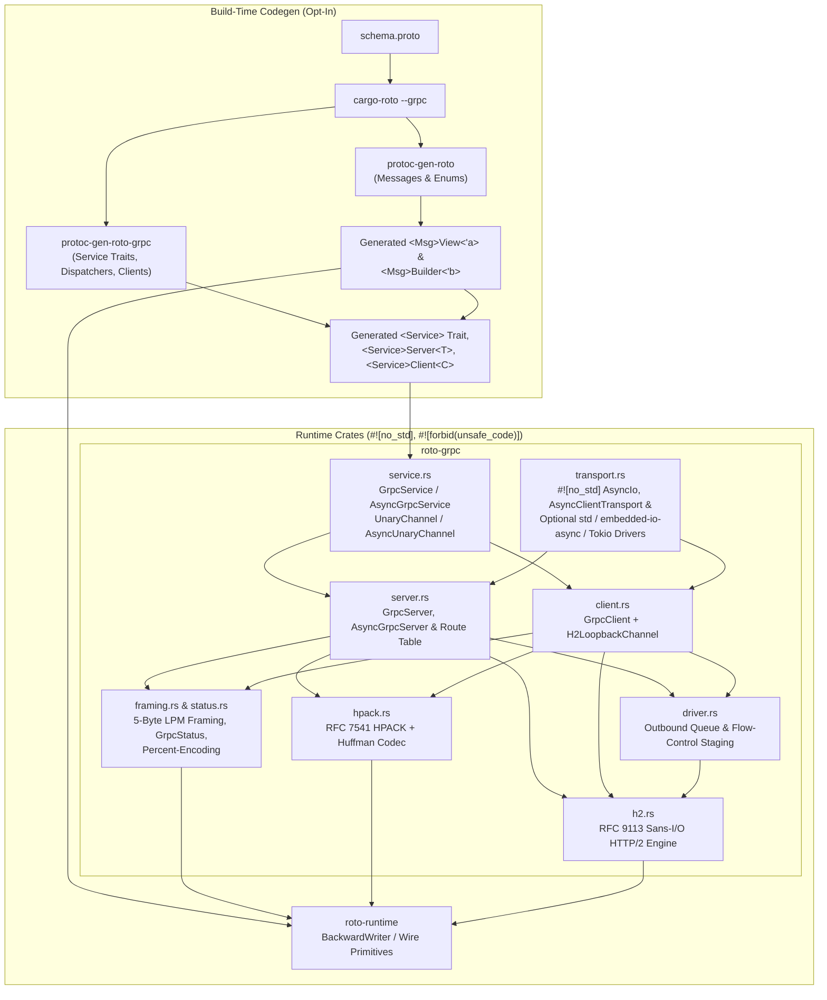
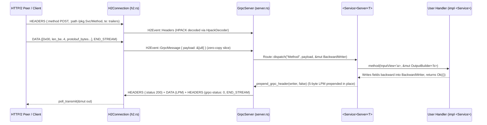
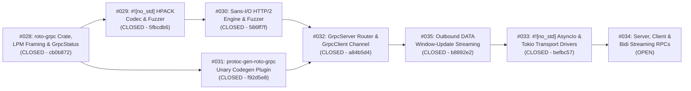

# `roto-grpc`: Zero-Copy `#![no_std]` gRPC over HTTP/2

`roto-grpc` and `protoc-gen-roto-grpc` provide an opt-in, `#![no_std]`, zero-allocation gRPC server and client implementation built around `roto`'s zero-copy Protobuf views (`<Msg>View<'a>`) and single-pass backward builders (`<Msg>Builder<'b>`).

Core `roto` crates ([`roto-runtime`](../roto-runtime), [`roto`](../roto), and [`protoc-gen-roto`](../protoc-gen-roto)) remain 100% focused on raw Protobuf wire encoding with zero gRPC dependencies.

---

## 1. Architecture

### Component Relationships



### Zero-Copy Request & Single-Pass Backward Response Flow

1. **Inbound Request (Zero-Copy Fast Path)**:
   - When an HTTP/2 `DATA` frame arrives containing a complete 5-byte gRPC Length-Prefixed Message (LPM) header and payload, [`H2Connection::recv`](../roto-grpc/src/h2.rs) emits `H2Event::GrpcMessage` whose `payload: &'a [u8]` slice borrows directly from the caller's input buffer with zero copying.
   - If a gRPC message straddles multiple HTTP/2 `DATA` frames, `H2Connection` reassembles it into the stream's fixed-capacity inline buffer (`REASM_CAP`).
   - The generated `<Service>Server<T>` constructs `<Input>View::from_bytes(req_payload)` directly over that borrowed slice and invokes the user's trait method.
2. **Outbound Response (Single-Pass `BackwardWriter`)**:
   - The user's handler populates `<Output>Builder<'b>` directly onto a [`BackwardWriter<'b>`](../roto-runtime/src/writer.rs) backed by the server's `msg_buf`.
   - Once the handler returns `Ok(())`, [`prepend_grpc_header`](../roto-grpc/src/framing.rs) prepends the 5-byte `[compressed_flag, len_be_0..4]` gRPC LPM header directly in front of the serialized Protobuf fields in the same buffer without moving a single byte.



---

## 2. Basic How-To Guide

### Step 1: Define a `.proto` Service

Create `proto/sensor.proto`:

```protobuf
syntax = "proto3";
package telemetry.v1;

message Location {
  optional int32 lat_e7 = 1;
  optional int32 lon_e7 = 2;
}

message SensorReading {
  optional string device_id = 1;
  optional uint64 timestamp_ms = 2;
  optional Location location = 3;
}

service SensorCollector {
  rpc ReportLocation(SensorReading) returns (Location);
}
```

### Step 2: Generate `roto` Messages and `roto-grpc` Service Stubs

`protoc-gen-roto-grpc` is strictly opt-in. `cargo-roto` automatically discovers `.proto` files inside `--proto-dir` (defaulting to `<crate_root>/proto`) or via `[package.metadata.roto]` in `Cargo.toml` — it does not take `--proto-path` or positional `.proto` file arguments:

```bash
# Generate both roto message views/builders and roto-grpc service traits/stubs
# (defaults to --proto-dir proto and --out-dir src):
cargo roto --grpc

# Or explicitly override the source .proto directory and output directory:
cargo roto --proto-dir proto --out-dir src/generated --grpc
```

Or configure `[package.metadata.roto]` in `Cargo.toml` so plain `cargo roto` runs with your project settings:

```toml
[dependencies]
roto = { path = "../roto", default-features = false }
roto-runtime = { path = "../roto-runtime", default-features = false }
roto-grpc = { path = "../roto-grpc", default-features = false }

[package.metadata.roto]
proto_paths = ["proto"]          # or `proto_dir = "proto"` (default: "proto")
inputs = ["proto/sensor.proto"]  # optional explicit input files (or `provides = ["telemetry"]`)
out_dir = "src"                  # output directory (default: "src", e.g. "src/generated")
mode = "lib"                     # "lib" (default, emits lib.rs) or "mod" (emits mod.rs + per-package files)
grpc = true                      # invoke protoc-gen-roto-grpc and emit grpc.rs
```

For `package telemetry.v1;`, running `cargo roto --grpc` produces two files in the output directory (`src/` by default):
- **`src/lib.rs`** (or `src/mod.rs` in `mode = "mod"`):
  - `pub mod telemetry { pub mod v1 { ... } }` containing `LocationView<'a>`, `LocationBuilder<'b>`, `SensorReadingView<'a>`, and `SensorReadingBuilder<'b>`
  - `pub mod grpc;` (automatically appended by `cargo-roto` when `--grpc` or `grpc = true` is enabled)
- **`src/grpc.rs`**:
  - `pub mod telemetry { pub mod v1 { pub mod sensor_collector { ... } } }` containing:
    - `pub const SERVICE_NAME: &str = "telemetry.v1.SensorCollector"` and `pub const PATH_REPORT_LOCATION: &str = "/telemetry.v1.SensorCollector/ReportLocation"`
    - `pub trait SensorCollector` (sync zero-copy server handler trait)
    - `pub trait AsyncSensorCollector` (async zero-copy server handler trait)
    - `pub struct SensorCollectorServer<T>` (implements [`GrpcService`](../roto-grpc/src/service.rs), [`AsyncGrpcService`](../roto-grpc/src/service.rs), [`Route`](../roto-grpc/src/server.rs), and [`AsyncRouter`](../roto-grpc/src/server.rs))
    - `pub struct SensorCollectorClient<C>` (typed client stub over [`UnaryChannel`](../roto-grpc/src/service.rs) or [`AsyncUnaryChannel`](../roto-grpc/src/service.rs))

### Step 3: Implement the Generated Service Trait

Your handler imports the generated message types from `<crate>::telemetry::v1` and the gRPC service trait from `<crate>::grpc::telemetry::v1::sensor_collector` (shown below using `crate::`, or e.g. `roto_test::` when importing from `main.rs` or an external binary). It borrows the request view directly from the incoming frame and writes the response into the builder without heap allocations:

```rust
use roto_grpc::GrpcStatus;
use crate::grpc::telemetry::v1::sensor_collector::{SensorCollector, SensorCollectorServer};
use crate::telemetry::v1::{LocationBuilder, SensorReadingView};

pub struct MySensorHandler;

impl SensorCollector for MySensorHandler {
    fn report_location<'a, 'b>(
        &self,
        req: SensorReadingView<'a>,
        resp: &mut LocationBuilder<'b>,
    ) -> Result<(), GrpcStatus<'static>> {
        let Some(loc) = req
            .location()
            .map_err(|_| GrpcStatus::internal("corrupt location submessage"))?
        else {
            return Err(GrpcStatus::invalid_argument("missing location"));
        };
        let lat = loc.lat_e7().map_err(|_| GrpcStatus::internal("corrupt lat"))?;
        let lon = loc.lon_e7().map_err(|_| GrpcStatus::internal("corrupt lon"))?;

        // Populate response fields (written backward into BackwardWriter):
        resp.write_lon_e7(lon + 1).write_lat_e7(lat + 1);
        Ok(())
    }
}
```

### Step 4: Run a Server and Client Over HTTP/2

#### A. Local Development TCP Server & Client: Direct Sans-I/O Loop (`std::net::TcpListener`)

Because [`GrpcServer`](../roto-grpc/src/server.rs) is a pure `#![no_std]` Sans-I/O HTTP/2 engine, you can drive it directly from any byte stream (`std::net::TcpStream`, a UART, or a wireless socket) with zero adapter magic:
1. Read raw bytes from the socket into `io_buf`.
2. Pass `&io_buf[..rx_n]` to [`server.recv(...)`](../roto-grpc/src/server.rs) — when a complete HTTP/2 request arrives, `server.recv` **synchronously invokes your `SensorCollector` handler** and queues the HTTP/2 response headers, LPM payload, and `grpc-status` trailers into `tx_buf`.
3. Drain outbound frames via [`server.poll_transmit(&mut io_buf)`](../roto-grpc/src/server.rs) and write them back to the socket.

```rust
use std::io::{Read, Write};
use std::net::TcpListener;
use roto_grpc::{GrpcServer, Route};
use crate::grpc::telemetry::v1::sensor_collector::SensorCollectorServer;

fn run_local_server() -> std::io::Result<()> {
    let listener = TcpListener::bind("127.0.0.1:50051")?;
    let svc = SensorCollectorServer::new(MySensorHandler);
    let routes: [&dyn Route; 1] = [&svc];

    let mut msg_buf = [0u8; 1024];
    let mut tx_buf = [0u8; 4096];
    let mut io_buf = [0u8; 4096];
    let mut server: GrpcServer = GrpcServer::new(&routes, &mut msg_buf, &mut tx_buf);

    for stream in listener.incoming() {
        let mut stream = stream?;
        let _ = stream.set_nodelay(true);
        server.reset();

        loop {
            // 1. Flush all queued outbound HTTP/2 frames (initial SETTINGS, ACKs, RPC responses)
            loop {
                let tx_n = server.poll_transmit(&mut io_buf);
                if tx_n == 0 {
                    break;
                }
                stream.write_all(&io_buf[..tx_n])?;
            }
            stream.flush()?;

            // 2. Read incoming bytes from the TCP socket
            let rx_n = stream.read(&mut io_buf)?;
            if rx_n == 0 {
                break; // Client closed connection (EOF)
            }

            // 3. Feed bytes into GrpcServer -> triggers MySensorHandler when a request completes
            if server.recv(&io_buf[..rx_n]).is_err() {
                let tx_n = server.poll_transmit(&mut io_buf);
                if tx_n > 0 {
                    let _ = stream.write_all(&io_buf[..tx_n]);
                }
                break;
            }
        }
    }
    Ok(())
}
```

#### B. Feature-Gated `std` and `tokio` TCP Drivers

To avoid writing the read/write loop by hand during local development or host testing, enable the optional `std` or `tokio` features on `roto-grpc`:

**Blocking `std::net` TCP (`roto-grpc = { ..., features = ["std"] }`):**

```rust
use std::net::TcpListener;
use roto_grpc::{
    DEFAULT_MAX_STREAMS, DEFAULT_REASM_CAP, GrpcServer, Route, accept_and_serve_std,
    connect_std_tcp,
};
use crate::grpc::telemetry::v1::sensor_collector::{SensorCollectorClient, SensorCollectorServer};
use crate::telemetry::v1::SensorReadingBuilder;

let listener = TcpListener::bind("127.0.0.1:0")?;
let addr = listener.local_addr()?;

// Spawn a blocking std TCP server for one connection:
let server_handle = std::thread::spawn(move || {
    let svc = SensorCollectorServer::new(MySensorHandler);
    let routes: [&dyn Route; 1] = [&svc];
    let (mut msg_buf, mut stx) = ([0u8; 1024], [0u8; 4096]);
    let mut server: GrpcServer = GrpcServer::new(&routes, &mut msg_buf, &mut stx);
    accept_and_serve_std(&listener, &mut server)
});

// Connect a blocking std TCP client and send a borrowed request:
let (mut ctx, mut call_buf) = ([0u8; 4096], [0u8; 1024]);
let transport = connect_std_tcp::<_, DEFAULT_MAX_STREAMS, DEFAULT_REASM_CAP>(
    addr, "http", "localhost", &mut ctx, &mut call_buf,
)?;
let mut stub = SensorCollectorClient::new(transport);

let mut req_buf = [0u8; 128];
let mut req = SensorReadingBuilder::new(&mut req_buf);
req.write_location(|lb| {
    lb.write_lon_e7(2000).write_lat_e7(1000);
})
.write_device_id("rp2040-node-1")
.write_timestamp_ms(42);

// Pass `&req` by immutable borrow (can be inspected or reused across retries):
let loc_view = stub.report_location(&req).expect("RPC succeeded");
assert_eq!((loc_view.lat_e7(), loc_view.lon_e7()), (Ok(1001), Ok(2001)));

drop(stub); // Closing the client stream lets accept_and_serve_std exit cleanly
server_handle.join().unwrap()?;
```

> [!TIP]
> Generated client stubs accept `&SensorReadingBuilder<'_>`, `SensorReadingBuilder<'_>`, `SensorReadingView<'_>`, `&SensorReadingView<'_>`, or `&[u8]` directly via the generated `ReportLocationRequest<'a>` trait — so you can also forward an already-decoded `SensorReadingView` (`stub.report_location(&incoming_view)`) without rebuilding it. If you prefer in-place closure construction directly into the channel's `call_buf`, use `stub.report_location_with(|req| { ... })` (or `stub.report_location_with_async(|req| { ... }).await`).

**Async `tokio::net` TCP (`roto-grpc = { ..., features = ["tokio"] }`):**

```rust
use tokio::net::TcpListener;
use roto_grpc::{
    DEFAULT_MAX_STREAMS, DEFAULT_REASM_CAP, GrpcServer, Route, accept_and_serve_tokio,
    connect_tokio_tcp,
};
use crate::grpc::telemetry::v1::sensor_collector::{SensorCollectorClient, SensorCollectorServer};
use crate::telemetry::v1::SensorReadingBuilder;

let listener = TcpListener::bind("127.0.0.1:0").await?;
let addr = listener.local_addr()?;

let mut ctx = [0u8; 4096];
let mut call_buf = [0u8; 1024];
let transport = connect_tokio_tcp::<_, DEFAULT_MAX_STREAMS, DEFAULT_REASM_CAP>(
    addr, "http", "localhost", &mut ctx, &mut call_buf,
).await?;
let mut stub = SensorCollectorClient::new(transport);

let mut req_buf = [0u8; 128];
let mut req = SensorReadingBuilder::new(&mut req_buf);
req.write_location(|lb| {
    lb.write_lon_e7(2000).write_lat_e7(1000);
});

// Invoke `stub.report_location_async(&req).await` while `accept_and_serve_tokio(&listener, &mut server)` runs
```

#### C. Embedded `#![no_std]` TCP Server on RP2040W (`cyw43` + `embassy-net`)

On an RP2040W wireless node running `embassy-net` (`embassy_net::tcp::TcpSocket`), use [`roto_grpc::impl_async_io!`](../roto-grpc/src/transport.rs) to generate a zero-allocation [`AsyncIo`](../roto-grpc/src/transport.rs) adapter around `TcpSocket<'a>` (or any `embedded_io_async::{Read, Write}` stream) and drive [`serve_connection`](../roto-grpc/src/transport.rs):

```rust
#![no_std]

use embassy_net::{Stack, tcp::{Error as TcpError, TcpSocket}};
use roto_grpc::{GrpcServer, Route, impl_async_io, serve_connection};
use crate::grpc::telemetry::v1::sensor_collector::SensorCollectorServer;

// Generate a zero-allocation `#![no_std]` AsyncIo wrapper around `embassy_net::tcp::TcpSocket`:
// (Or for any generic `embedded_io_async::{Read, Write}` type:
//  `impl_async_io!(embedded_io_async: pub struct EmbeddedIo<T>(T));`)
impl_async_io!(pub struct EmbassyTcpIo<'a>(TcpSocket<'a>) -> TcpError);

pub async fn rp2040w_grpc_server_task(stack: Stack<'static>) -> ! {
    let svc = SensorCollectorServer::new(MySensorHandler);
    let routes: [&dyn Route; 1] = [&svc];

    let mut rx_buf = [0u8; 4096];
    let mut tx_buf = [0u8; 4096];
    let mut msg_buf = [0u8; 1024];
    let mut h2_tx_buf = [0u8; 4096];
    let mut server: GrpcServer = GrpcServer::new(&routes, &mut msg_buf, &mut h2_tx_buf);

    loop {
        let mut socket = TcpSocket::new(stack, &mut rx_buf, &mut tx_buf);
        if socket.accept(50051).await.is_err() {
            continue;
        }
        server.reset();
        let mut io = EmbassyTcpIo::new(socket);
        let _ = serve_connection(&mut server, &mut io).await;
        io.into_inner().close();
    }
}
```

You can also drive [`serve_connection`](../roto-grpc/src/transport.rs) and [`AsyncClientTransport`](../roto-grpc/src/transport.rs) over any custom `#![no_std]` [`AsyncIo`](../roto-grpc/src/transport.rs) stream (such as [`MemoryDuplex`](../roto-grpc/src/transport.rs) or an RP2040 UART/USB-CDC peripheral):

```rust
use roto_grpc::{
    AsyncClientTransport, GrpcClient, GrpcServer, MemoryDuplex, Route, block_on_pair,
    serve_connection,
};
use crate::grpc::telemetry::v1::sensor_collector::{SensorCollectorClient, SensorCollectorServer};
use crate::telemetry::v1::SensorReadingBuilder;

let duplex: MemoryDuplex<1024> = MemoryDuplex::new();
let (client_io, mut server_io) = duplex.split();

let svc = SensorCollectorServer::new(MySensorHandler);
let routes: [&dyn Route; 1] = [&svc];
let (mut msg_buf, mut stx, mut ctx, mut call_buf) =
    ([0u8; 512], [0u8; 2048], [0u8; 2048], [0u8; 512]);

let mut server: GrpcServer = GrpcServer::new(&routes, &mut msg_buf, &mut stx);
let client: GrpcClient = GrpcClient::new("http", "localhost", &mut ctx);
let mut stub = SensorCollectorClient::new(AsyncClientTransport::new(
    client_io,
    client,
    &mut call_buf,
));

let mut req_buf = [0u8; 128];
let mut req = SensorReadingBuilder::new(&mut req_buf);
req.write_location(|lb| {
    lb.write_lon_e7(400).write_lat_e7(300);
});

let (client_res, server_res) = block_on_pair(
    async {
        let loc = stub.report_location_async(&req).await?;
        let pair = (loc.lat_e7().unwrap(), loc.lon_e7().unwrap());
        stub.into_inner().into_inner().close(); // Signal clean EOF to server
        Ok::<_, roto_grpc::GrpcStatus<'_>>(pair)
    },
    serve_connection(&mut server, &mut server_io),
);
assert_eq!(client_res.unwrap(), (301, 401));
assert!(server_res.is_ok());
```

#### D. In-Memory HTTP/2 Unit Testing (`H2LoopbackChannel`)

For fast, deterministic unit tests without sockets, [`H2LoopbackChannel`](../roto-grpc/src/client.rs) pairs a [`GrpcClient`](../roto-grpc/src/client.rs) and [`GrpcServer`](../roto-grpc/src/server.rs) over real HTTP/2 framing (connection preface, `SETTINGS`, HPACK headers, LPM `DATA` frames, flow-control windows, and trailers):

```rust
use roto_grpc::{GrpcClient, GrpcServer, H2LoopbackChannel, Route};
use crate::grpc::telemetry::v1::sensor_collector::{SensorCollectorClient, SensorCollectorServer};
use crate::telemetry::v1::SensorReadingBuilder;

let svc = SensorCollectorServer::new(MySensorHandler);
let routes: [&dyn Route; 1] = [&svc];

let mut msg_buf = [0u8; 512];
let mut server_tx = [0u8; 2048];
let mut client_tx = [0u8; 2048];
let mut call_buf = [0u8; 512];

let server: GrpcServer = GrpcServer::new(&routes, &mut msg_buf, &mut server_tx);
let client: GrpcClient = GrpcClient::new("http", "localhost", &mut client_tx);
let mut stub = SensorCollectorClient::new(H2LoopbackChannel::new(client, server, &mut call_buf));

let mut req_buf = [0u8; 128];
let mut req = SensorReadingBuilder::new(&mut req_buf);
req.write_location(|lb| {
    lb.write_lon_e7(2000).write_lat_e7(1000);
})
.write_device_id("rp2040-node-1")
.write_timestamp_ms(42);

// Invoke unary RPC with `&req` and read the borrowed zero-copy LocationView response:
let loc_view = stub.report_location(&req).expect("RPC succeeded");

assert_eq!(loc_view.lat_e7(), Ok(1001));
assert_eq!(loc_view.lon_e7(), Ok(2001));
```

#### E. Multiplexing Concurrent Calls with `GrpcClient` and `GrpcServer`

To multiplex concurrent calls on a single HTTP/2 connection over any custom socket/UART/USB transport, start multiple in-flight streams and shuttle bytes between `poll_transmit` and `recv`:

```rust
use roto_grpc::{GrpcClient, GrpcServer, Route, take_writer};
use crate::grpc::telemetry::v1::sensor_collector::{PATH_REPORT_LOCATION, SensorCollectorServer};
use crate::telemetry::v1::{LocationView, SensorReadingBuilder};

let svc = SensorCollectorServer::new(MySensorHandler);
let routes: [&dyn Route; 1] = [&svc];

let (mut msg_buf, mut stx, mut ctx) = ([0u8; 512], [0u8; 2048], [0u8; 2048]);
let mut server: GrpcServer = GrpcServer::new(&routes, &mut msg_buf, &mut stx);
let mut client: GrpcClient = GrpcClient::new("http", "localhost", &mut ctx);

let (mut buf_a, mut buf_b, mut wire) = ([0u8; 128], [0u8; 128], [0u8; 512]);

// Start two concurrent RPCs on odd HTTP/2 stream IDs (stream 1 and stream 3):
let stream_a = client.start_call(PATH_REPORT_LOCATION, &mut buf_a, |w| {
    let mut req = SensorReadingBuilder::from_writer(take_writer(w));
    req.write_location(|lb| { lb.write_lon_e7(20).write_lat_e7(10); });
    *w = req.writer;
}).unwrap();

let stream_b = client.start_call(PATH_REPORT_LOCATION, &mut buf_b, |w| {
    let mut req = SensorReadingBuilder::from_writer(take_writer(w));
    req.write_location(|lb| { lb.write_lon_e7(200).write_lat_e7(100); });
    *w = req.writer;
}).unwrap();

// Shuttle HTTP/2 frames between client and server:
loop {
    let n = client.poll_transmit(&mut wire);
    server.recv(&wire[..n]).unwrap();
    let m = server.poll_transmit(&mut wire);
    client.recv(&wire[..m]).unwrap();
    if n == 0 && m == 0 {
        break;
    }
}

// Collect replies in any order and reuse call buffers via reply.into_buf():
let reply_b = client.take_reply(stream_b).unwrap();
let loc_b = LocationView::from_bytes(reply_b.result().unwrap()).unwrap();
assert_eq!((loc_b.lat_e7(), loc_b.lon_e7()), (Ok(101), Ok(201)));

let reply_a = client.take_reply(stream_a).unwrap();
let loc_a = LocationView::from_bytes(reply_a.result().unwrap()).unwrap();
assert_eq!((loc_a.lat_e7(), loc_a.lon_e7()), (Ok(11), Ok(21)));
```

### Step 5: Running the Test & Verification Suites

```bash
# Run all workspace unit, integration, and bare-metal #![no_std] checks:
make test

# Verify bare-metal ARM targets (Cortex-M4F thumbv7em-none-eabihf & RP2040 thumbv6m-none-eabi):
make check-nostd

# Run specific gRPC test suites (in-memory loopback, std/Tokio TCP E2E, and codegen):
cargo test -p roto-grpc --test grpc_loopback
cargo test -p roto-grpc --features std,embedded-io-async,tokio --test transport_e2e
cargo test -p protoc-gen-roto-grpc --test e2e_grpc_codegen

# Run deterministic HPACK, HTTP/2, and gRPC fuzzers:
make fuzz
```

---

## 3. Implementation Status Matrix

### gRPC Wire Protocol (`PROTOCOL-HTTP2.md`)

| Feature | Status | Notes / Location |
| :--- | :---: | :--- |
| **5-Byte Length-Prefixed Message (LPM) Framing** | Implemented | [`framing.rs`](../roto-grpc/src/framing.rs): zero-copy single-frame decode + single-pass `BackwardWriter` encode |
| **gRPC Status Codes (`0..=16`) & `GrpcStatus`** | Implemented | [`status.rs`](../roto-grpc/src/status.rs): all 17 canonical codes (`GrpcCode`) |
| **`grpc-message` Percent-Encoding (RFC 3986)** | Implemented | [`status.rs`](../roto-grpc/src/status.rs): forward/backward percent-encode + in-place/scratch decode |
| **Unary RPC Codegen (`GrpcService`, `AsyncGrpcService`)** | Implemented | [`protoc-gen-roto-grpc`](../protoc-gen-roto-grpc/src/generator.rs) & [`service.rs`](../roto-grpc/src/service.rs) |
| **Multi-Service Server Routing (`/{service}/{method}`)** | Implemented | [`server.rs`](../roto-grpc/src/server.rs): sync `Route` slice `&[&dyn Route]` (`GrpcServer`) + async `AsyncRouter` (`AsyncGrpcServer`), zero heap allocation |
| **Request Header Validation (`:method POST`, `te: trailers`, `content-type`)** | Implemented | [`server.rs`](../roto-grpc/src/server.rs): accepts `application/grpc`, `application/grpc+roto`, `application/grpc+proto`, `;...` |
| **Trailers-Only Error Responses** | Implemented | [`server.rs`](../roto-grpc/src/server.rs) & [`client.rs`](../roto-grpc/src/client.rs): single `HEADERS` frame with `END_STREAM` |
| **HTTP `:status` to `GrpcCode` Fallback Mapping** | Implemented | [`client.rs`](../roto-grpc/src/client.rs): `400->Internal`, `401->Unauthenticated`, `403->PermissionDenied`, `404->Unimplemented`, `429/502/503/504->Unavailable`, else `Unknown` |
| **`#![no_std]` Async Transport & Optional `std` / `embedded-io-async` / `tokio` Drivers** | Implemented | [`transport.rs`](../roto-grpc/src/transport.rs): `AsyncIo`, `AsyncClientTransport`, `serve_connection`, `serve_async_connection`, `MemoryDuplex`, `impl_async_io!`, `StdIo`, `StdClientTransport`, `connect_std_tcp`, `accept_and_serve_std`, `TokioIo`, `connect_tokio_tcp`, `accept_and_serve_tokio`, RP2040 `thumbv6m-none-eabi` verified (`#033`, `#041`) |
| **Server, Client, and Bidirectional Streaming RPCs** | Planned (`#034`) | Fast-follow issue after `#033` |
| **Payload Compression (`grpc-encoding: gzip / deflate`)** | Not Implemented | Compressed flag `1` is rejected with `GrpcCode::Internal` per spec when unnegotiated |
| **`grpc-timeout` Deadline Parsing & Enforcement** | Not Implemented | Header is parsed/ignored; timeout enforcement left to transport/caller |
| **Custom Metadata (`*-bin` / ASCII user headers)** | Not Implemented | Known gRPC pseudo-headers and headers are extracted; custom metadata headers are skipped |

### HTTP/2 (RFC 9113) & HPACK (RFC 7541)

| Feature | Status | Notes / Location |
| :--- | :---: | :--- |
| **24-Byte Client Connection Preface** | Implemented | [`h2.rs`](../roto-grpc/src/h2.rs): validated by `Role::Server`, queued automatically by `Role::Client` |
| **`DATA` (`0x0`) Frame (including `FLAG_PADDED`)** | Implemented | [`h2.rs`](../roto-grpc/src/h2.rs): zero-copy single-frame fast path + incremental multi-frame LPM reassembly |
| **`HEADERS` (`0x1`) & `CONTINUATION` (`0x9`)** | Implemented | [`h2.rs`](../roto-grpc/src/h2.rs): handles `FLAG_PADDED` and `FLAG_PRIORITY`; enforces strict `CONTINUATION` lock; auto-splits large outbound header blocks |
| **`PRIORITY` (`0x2`) Frame** | Implemented | [`h2.rs`](../roto-grpc/src/h2.rs): validates stream ID != 0 and 5-byte length, ignores priority weight per RFC 9113 |
| **`RST_STREAM` (`0x3`) & Per-Stream Error Recovery** | Implemented | [`h2.rs`](../roto-grpc/src/h2.rs): emits `H2Event::StreamError`, queues `RST_STREAM`, discards remaining frame bytes without desyncing connection |
| **`SETTINGS` (`0x4`) & Automatic `SETTINGS` ACK** | Implemented | [`h2.rs`](../roto-grpc/src/h2.rs): validates frame size & bounds; applies `SETTINGS_INITIAL_WINDOW_SIZE` deltas across active streams |
| **`PUSH_PROMISE` (`0x5`) Rejection** | Implemented | [`h2.rs`](../roto-grpc/src/h2.rs): advertises `SETTINGS_ENABLE_PUSH = 0` and rejects peer `PUSH_PROMISE` with `ProtocolError` |
| **`PING` (`0x6`) & Automatic `PING` ACK** | Implemented | [`h2.rs`](../roto-grpc/src/h2.rs): validates stream 0 and 8-byte payload; auto-queues `PING` ACK |
| **`GOAWAY` (`0x7`) Graceful Shutdown** | Implemented | [`h2.rs`](../roto-grpc/src/h2.rs) & [`client.rs`](../roto-grpc/src/client.rs): fails calls `> last_stream_id` with `Unavailable` while allowing `<= last_stream_id` to complete |
| **`WINDOW_UPDATE` (`0x8`) & Send-Window Queuing** | Implemented | [`h2.rs`](../roto-grpc/src/h2.rs), [`driver.rs`](../roto-grpc/src/driver.rs), [`server.rs`](../roto-grpc/src/server.rs), [`client.rs`](../roto-grpc/src/client.rs): automatic receive-window replenishment + outbound `DATA` streaming across `WINDOW_UPDATE` credit (`#035`) |
| **HPACK Static Table (61 entries) & Huffman Codec** | Implemented | [`hpack.rs`](../roto-grpc/src/hpack.rs): full RFC 7541 Appendix A & B static table + EOS/padding validation |
| **HPACK Dynamic Table (`DynamicTable<CAP>`)** | Implemented | [`hpack.rs`](../roto-grpc/src/hpack.rs): FIFO eviction in fixed-capacity ring buffer; `GrpcServer`/`GrpcClient` advertise `SETTINGS_HEADER_TABLE_SIZE = 0` for stateless decoding |
| **TLS / ALPN (`h2`)** | Out of Scope | Sans-I/O engine operates on decrypted byte streams (`h2c` or caller-terminated TLS) |

---

## 4. Milestone Timeline & Roadmap



| Issue | Status | Commit | Deliverables |
| :--- | :---: | :---: | :--- |
| **[#028](../issues/grpc/028-initialize-roto-grpc-no-std-crate-and-grpc-lpm-status-framing-primitives.md)** | `CLOSED` | `cb0b872` | Initialized `roto-grpc` (`#![no_std]`, `#![forbid(unsafe_code)]`), 5-byte LPM framing (`framing.rs`), `GrpcCode` & `GrpcStatus`, RFC 3986 percent-encoding (`status.rs`). |
| **[#029](../issues/grpc/029-implement-no-std-zero-allocation-hpack-encoder-and-decoder-rfc-7541-with-deterministic-fuzzer.md)** | `CLOSED` | `5fbcdb6` | RFC 7541 HPACK static/dynamic tables, Huffman encoder/decoder, gRPC header helpers (`hpack.rs`), and deterministic `SplitMix64` fuzzer (`fuzz_hpack.rs`). |
| **[#031](../issues/grpc/031-create-standalone-protoc-gen-roto-grpc-plugin-crate-for-zero-copy-unary-grpc-service-and-client-codegen.md)** | `CLOSED` | `f92d5e8` | Standalone `protoc-gen-roto-grpc` binary/library crate, `cargo-roto --grpc` integration, `GrpcService` / `AsyncGrpcService` / `UnaryChannel` / `LoopbackChannel` (`service.rs`). |
| **[#030](../issues/grpc/030-implement-no-std-sans-i-o-http-2-connection-and-multiplexed-stream-engine-rfc-9113-with-fuzzer.md)** | `CLOSED` | `586ff7f` | RFC 9113 Sans-I/O `H2Connection` multiplexed stream engine, zero-copy single-frame `DATA` fast path, multi-frame LPM reassembly (`h2.rs`), and fuzzer (`fuzz_h2.rs`). |
| **[#032](../issues/grpc/032-implement-grpc-server-router-and-client-channel-machinery-over-sans-i-o-http-2.md)** | `CLOSED` | `a84b5d4` | `GrpcServer` multi-service router (`Route`), `GrpcClient` multiplexed unary channel, `H2LoopbackChannel`, stream-error recovery (`H2Event::StreamError`), loopback tests (`grpc_loopback.rs`), and fuzzer (`fuzz_grpc.rs`). |
| **[#035](../issues/grpc/035-queue-outbound-data-across-window-update-credit-instead-of-failing-with-resource-exhausted.md)** | `CLOSED` | `b8892e2` | Zero-allocation outbound `DATA` staging and resumption across `WINDOW_UPDATE` credit in `driver.rs`, `client.rs`, and `server.rs` (enabling > 64 KiB requests and responses). |
| **[#033](../issues/grpc/033-implement-no-std-embedded-io-async-rp2040-and-optional-tokio-transport-drivers-end-to-end-verification-suite.md)** | `CLOSED` | `befbc57` | `#![no_std]` `AsyncIo`, `AsyncClientTransport`, `AsyncGrpcServer`, `MemoryDuplex` (verified on `thumbv6m-none-eabi` RP2040 and `thumbv7em-none-eabihf`), optional `tokio` TCP server/client drivers (`TokioIo`, `connect_tokio_tcp`, `accept_and_serve_tokio`), and end-to-end socket test suite (`transport_e2e.rs`). |
| **[#034](../issues/grpc/034-fast-follow-add-server-client-and-bidirectional-streaming-rpc-codegen-and-stream-machinery.md)** | `OPEN` | — | Fast-follow: zero-copy lending `RecvStream` and `BackwardWriter` `SendStream` + codegen in `protoc-gen-roto-grpc` for server, client, and bidirectional streaming RPCs. |
